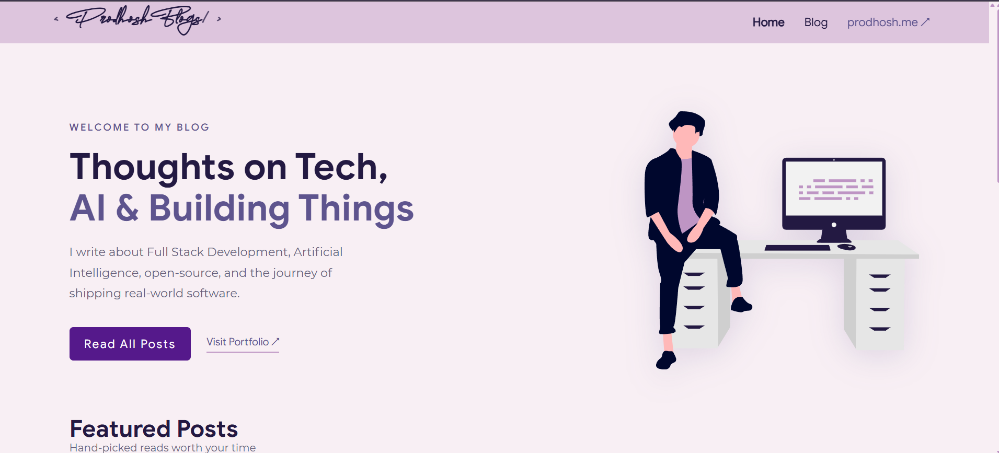
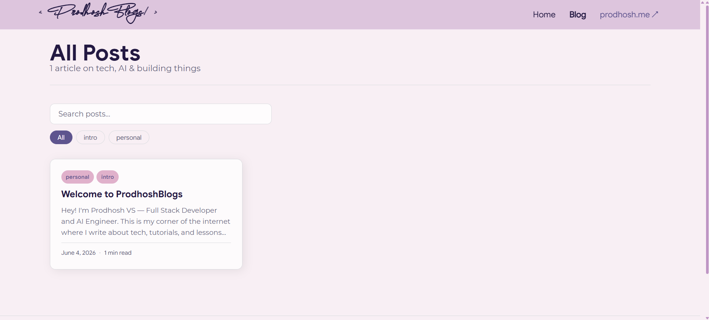

<div align="center">

<h1>ProdhoshBlogs</h1>

<p><em>My corner of the internet.</em></p>

<p>
  
  
  
  
  
</p>

<p>
  <a href="https://blog.prodhosh.me"></a>
  &nbsp;
  <a href="https://prodhosh.me"></a>
</p>

</div>

---

## Why I built this

I have been active on Medium and a few other writing platforms for a while now. Over time I realized two things.

First, I actually have a lot to share. Things I built, bugs I spent hours on, concepts I finally understood after weeks of confusion, tools that changed how I work. The kind of stuff that would have saved me time if someone had written it down clearly. So I started writing it down.

Second, none of those platforms felt like mine. Medium puts your content behind a paywall you did not set up. Other platforms bury your posts under an algorithm. You grow an audience but you are always one policy change away from losing reach. I wanted a place where I control everything, the design, the content, the experience.

So I built ProdhoshBlogs. It sits at `blog.prodhosh.me` right next to my portfolio. Same design, same feel, fully mine. No third party CMS, no lock-in, no subscriptions. Just me writing and publishing whenever I want.

---

## Screenshots

<div align="center">





</div>

---

## What I built

### Reading experience

- **Light-first design** with a dark mode toggle that remembers your choice. Same warm peach and orange as my portfolio, with Bricolage Grotesque, Instrument Serif and JetBrains Mono.
- **Home, article archive and topic pages.** Search, topic filters (shareable URLs), load-more, featured post, related posts and previous/next navigation.
- **Post pages** with a sticky table of contents, reading progress bar, heading anchors, syntax-highlighted code blocks with copy buttons, share bar (copy link, X, LinkedIn, WhatsApp, Reddit, native share) and optional Giscus comments.
- **RSS feed** (`/feed.xml`), sitemap with image entries, and a custom 404.
- Fully responsive. Tables and code scroll inside their own box, topic chips scroll sideways, and the menu is a full-screen drawer on phones.

### SEO and sharing

Every page gets its own canonical URL, Open Graph and Twitter tags, and JSON-LD (WebSite, Blog, BlogPosting, BreadcrumbList). Social cards are **generated on the fly** at `/og` from the post title, tags, date and cover image, so every shared link has a unique preview. Per-post SEO title and meta description overrides live in the editor, with a Google-style preview.

### Admin (`/admin`)

- Sign-in with password + authenticator code + Cloudflare Turnstile. Signed, expiring sessions, same-origin checks on every write, and login rate limiting.
- **Dashboard** with search, status filters (published, drafts, scheduled) and one-click publish/unpublish.
- **Editor** with formatting toolbar, live split preview that uses the exact same pipeline as the public site, auto-slug, tag chips, cover image, featured flag, publish scheduling, SEO panel, Ctrl+S, autosave to the browser and an unsaved-changes warning.
- **Media library.** Drag, drop or paste images. They are resized and compressed in the browser, then stored in Postgres and served from `/media/...` with long-lived caching. No extra storage account needed.

Publishing revalidates the affected pages immediately, so a post is live the moment you press Publish.

---

## Setup

```bash
npm install
cp .env.local.example .env.local   # fill in the values
npm run db:push                    # creates/updates tables
npm run setup:2fa                  # prints your authenticator secret
npm run dev
```

---

## Tech stack

| What | Why |
|------|-----|
| Next.js 14 (Pages Router) | ISR support out of the box, posts go live fast without a full rebuild |
| Neon Postgres (AWS Singapore) | Serverless Postgres hosted on AWS ap-southeast-1, never pauses on the free tier, auto-resumes instantly |
| Drizzle ORM | Lightweight, clean database queries without the overhead of heavier ORMs |
| CSS Modules | Scoped styles with shared design tokens in `styles/globals.css` |
| unified / rehype | One markdown pipeline (GFM, sanitising, highlighting, TOC) shared by the site and the editor preview |
| next/og | Dynamic social cards on the edge |
| Vercel | Best Next.js hosting available, easy custom subdomain setup |

---

## Design

The blog shares its palette with [prodhosh.me](https://prodhosh.me) (warm peach, ink black and orange) and its type system with [links.prodhosh.me](https://links.prodhosh.me), so the three sites feel like one place.

---

<div align="center">

Made by [Prodhosh VS](https://prodhosh.me)

[](https://github.com/PRODHOSH)
[](https://www.linkedin.com/in/prodhoshvs/)
[](https://twitter.com/prodhosh3)
[](https://www.instagram.com/itzprodhosh/)
[](https://discord.com/users/itzprodhoshh)
[](mailto:prodhosh3@gmail.com)

</div>
